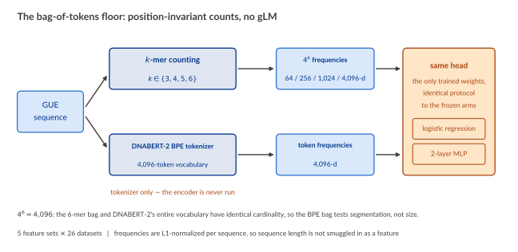
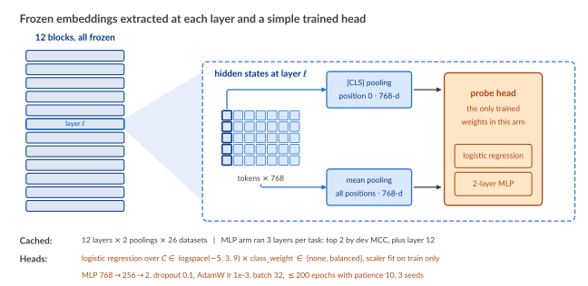
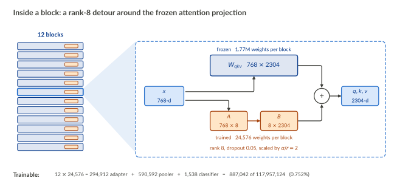
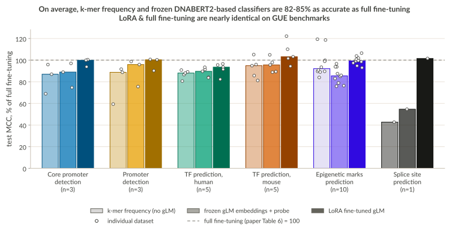
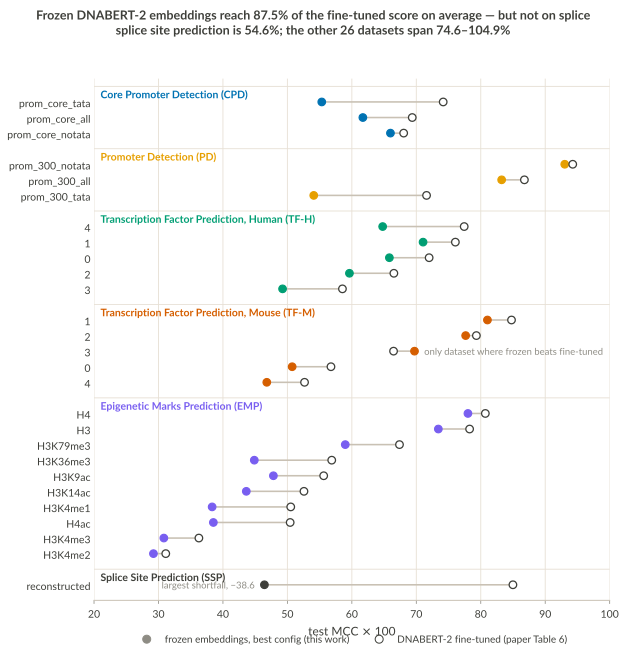
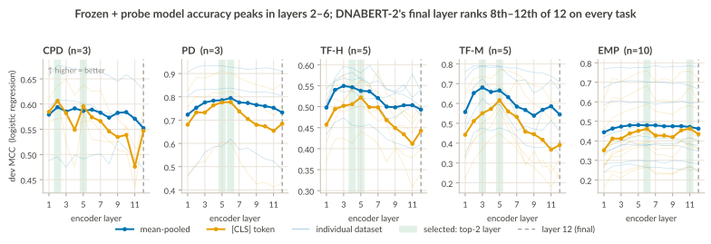
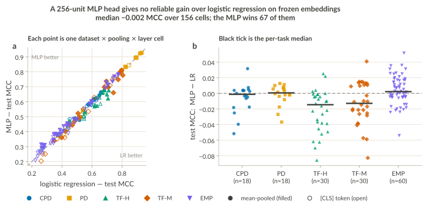
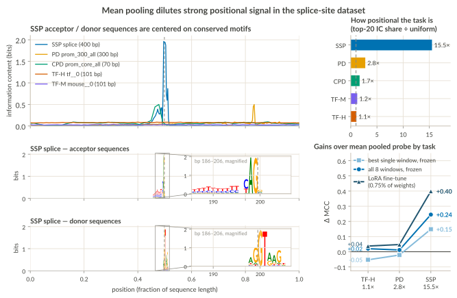
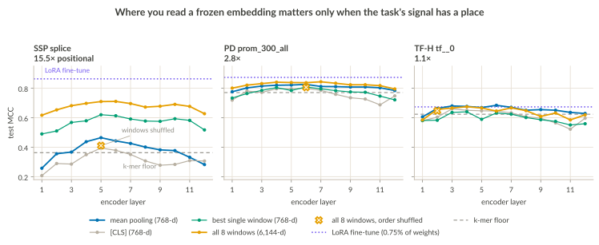
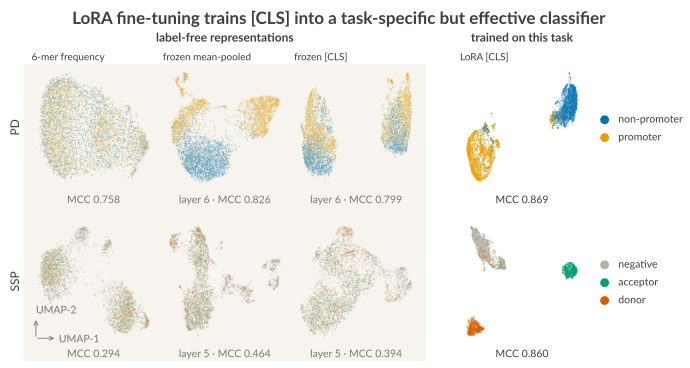

## Intro

In this post I'll explore DNABERT-2 [@zhou2024dnabert2], a genomic language model (gLM) published in 2024. gLM authors and subsequent benchmarking studies have made conflicting claims about gLM classification performance and best practices for task-specific training [@marin2024bend; @tang2025probing]. Here, I benchmark short-sequence motif classification performance in the [Genome Understanding Evaluation (GUE)](https://arxiv.org/abs/2306.15006) benchmark suite using a non-gLM baseline and a ladder of task-specific training approaches increasing in size and complexity. 

In principle, **fine-tuning a gLM that has already absorbed the statistics of millions of genomic positions should give a more accurate model than one trained only on a small number of labeled examples.** I test the following hypotheses to see how well DNABERT-2 fulfills these expectations:

```{=html}
<style>
/* Hypothesis callouts: no top/bottom margin so they stack tightly */
.callout.hypothesis { margin-top: 0; margin-bottom: 0; }
</style>
```

::: {.callout-note .hypothesis}
## H1 · Pre-training learns biology, not just nucleotide statistics
If self-supervised pre-training teaches DNABERT-2 genuine genomic structure — motifs, grammar, conservation — then its frozen embeddings should outclass features built from a baseline k-mer frequency model with no positional or contextual information. 

→ *Tested in [Frozen embeddings do not beat a k-mer bag](#frozen-embeddings-do-not-beat-a-k-mer-bag).*
:::

::: {.callout-note .hypothesis}
## H2 · Optimizing embedding layer selection improves probe model performance
Transformers tend to autonomously develop "layer specialization". Early layers often focus on token-level statistics, and deeper layers capture more abstract properties. Probe models trained on gLMs like Nucleotide Transformer have been reported to have the same properties [@dallatorre2024nt].

→ *Tested in [Layer selection affects probe performance](#sec-probe-performance).*
:::

&nbsp;

[See Methods for more detail](#methods). All models were compared with the full fine-tuning results published in the authors' original paper. Each tab shows one modeling approach I built:

::: {#model-tabset .panel-tabset .column-page-right}

## Baseline
{width=100% fig-alt="Schematic of the baseline arm. A GUE sequence box on the left splits into two featurization routes: k-mer counting for k in 3 to 6, giving 4^k frequencies of 64, 256, 1,024 or 4,096 dimensions; and the DNABERT-2 BPE tokenizer with its 4,096-token vocabulary, giving 4,096-dimensional token frequencies, annotated that the tokenizer alone is used and the encoder is never run. Both routes feed the same trained head, holding a logistic regression and a 2-layer MLP, the only trained weights. A footer notes that 4^6 = 4,096, so the 6-mer bag and DNABERT-2's entire vocabulary have identical cardinality, and that frequencies are L1-normalized per sequence."}

**Baseline:** Linear (logistic regression) and non-linear (2-layer MLP) models trained to predict class labels using a deliberately simple sequence embedding: k-mer frequency or BPE frequency.

- These models establish a floor for task difficulty and help evaluate whether DNABERT-2's training has actually learned genomic grammar.
- The BPE-encoded arm tests whether DNABERT-2's tokenizer, rather than its transformer, is responsible for performance gains.

## Frozen gLM + Probe
{width=100% fig-alt="Schematic of the frozen-probe arm. On the left, a stack of twelve frozen transformer blocks with one highlighted as layer ell. A wedge expands it on the right: the hidden states at layer ell, a matrix of tokens by 768 with the first column marked as position 0, feed two pooling routes — [CLS] pooling, taking position 0 as a 768-dimensional vector, and mean pooling, averaging all positions to 768 dimensions. Both feed a trained probe head holding a logistic regression and a 2-layer MLP, the only trained weights in the arm. Footer strips give the cached sweep of 12 layers by 2 poolings by 26 datasets, and the head hyperparameters."}

**Probe models:** The same scikit-learn models trained identically to the baseline, but using frozen DNABERT-2 embeddings extracted from each layer rather than nucleotide frequency features.

## LoRA fine-tuning
{width=100% fig-alt="Schematic of the LoRA arm. On the left, a stack of twelve transformer blocks, each carrying a small adapter, with one block highlighted. A wedge expands that block on the right: the 768-dimensional hidden state splits into two paths, a frozen 768 by 2304 Wqkv projection and a trained pair of low-rank matrices A (768 by 8) and B (8 by 2304), which are summed to give the 2304-dimensional q, k and v. A footer gives the parameter accounting: 294,912 adapter plus 590,592 pooler plus 1,538 classifier equals 887,042 of 117,957,124 weights, or 0.752%."}

**Low-rank adaptation (LoRA):** A rank-8 adapter learns a low-rank update alongside the frozen fused $W_{qkv}$ projection in each of the 12 blocks, and the pooler and classifier are trained in full. None of the original attention layers change.

- This approach trains less than 1% of the parameters fine-tuned in the paper.
- Unlike the frozen models, the classification head reads **[CLS] (a non-sequence token prepended at position 0) of the final encoder layer** through a `BertPooler` — dense 768→768→tanh, initialised from scratch and trained in full. 

:::


## Background:

### Genomic foundation models

A genomic language model (gLM) is a transformer pre-trained on raw DNA with no functional labels, in the hope that the representations it learns transfer to many downstream tasks at once. The premise is analogous to natural language processing (NLP) and protein modeling: train once on a large unlabeled corpus, then reuse the embeddings as general-purpose features. For genomics, general-purpose embeddings are promising because experimental data is limited. For nucleic acid constructs, high-throughput screening (HTS) is the gold standard for optimizing diverse characteristics like expression or activity. Fine-tuning gLMs with task-specific HTS data can enable *in silico* screening, improving the efficiency of costly screening campaigns. 


### DNABERT-2 architecture & limitations

DNABERT-2 is a BERT-style encoder with 117M parameters, pre-trained on 135 genomes (~32B nucleotides) via masked language modeling [@zhou2024dnabert2]. I chose it because it is small enough to fine-tune on a consumer GPU while still scoring competitively on sequence classification benchmarks [@marin2024bend], and because both its weights and its benchmark suite ship on HuggingFace. 

Three design choices shape what DNABERT-2 can do — how it tokenizes nucleotides, generalizes to different input lengths — and why it can't be used for sequence generation:

::: {.panel-tabset}

## Byte-Pair Encoding (BPE)

**A learned, variable-length vocabulary instead of fixed k-mers.**

DNABERT-2 builds a 4,096-token vocabulary by iteratively merging the most frequent adjacent genome segments [@sennrich2016bpe], rather than slicing DNA at fixed width. That fixes three problems with the k-mer tokenization used by its predecessor [@ji2021dnabert]:

- **Information leakage.** Overlapping k-mers share k−1 characters, so a masked token is partly given away by its neighbors.
- **Brittle embeddings.** With non-overlapping k-mers, a single base insertion — common between related non-coding sequences — reshuffles every token downstream of it.
- **Token efficiency.** BPE shortens a sequence roughly fivefold against one-hot encoding, while attention cost grows quadratically with length.

## ALiBi

**Position as a penalty, not a learned vector.**

Attention with Linear Biases drops learned position embeddings entirely, replacing them with a fixed penalty on attention scores that grows with the distance between two tokens [@press2022alibi]. 

This allows the model to extrapolate to sequences far longer than it saw in training. DNABERT-2 is pre-trained on short sequences but can be fine-tuned and run on inputs up to 10 kb.

## MLM Training

**Bidirectional context, at the cost of generation.**

Masked language modeling hides 15% of tokens and trains the model to predict them from the tokens on *both* sides. Genomic motifs are influenced by both 3' and 5' elements, so bidirectional context makes intuitive sense.

*The tradeoff is that DNABERT-2 might be useful for classification or functional prediction of provided sequences, but will never be useful for de novo sequence generation.*

:::

*That last limit is a design choice, not a law*. Evo 2 (a causally trained model) generates sequences & achieves state-of-the-art classification on many tasks with no fine-tuning at all [@brixi2025evo2].

::: {.callout-tip}
## Follow-up coming
Expect a post on sequence generation once I find a cost-effective way to run Evo 2.
:::


### LoRA: Low-rank adaptation of large language models

Low-rank adaptation (LoRA) is a parameter-efficient fine-tuning method for large pre-trained transformer models that has been shown to match full fine-tuning on a range of tasks while being significantly more storage- and compute-efficient [@hu2022lora]. In the original DNABERT-2 paper, the full model was fine-tuned separately for each classification task in the GUE benchmark, producing an independent 117M-parameter model per task.

Assuming that task-agnostic pre-training already teaches a genomic language model to encode general features of DNA sequences, retraining the entire parameter space for each task shouldn't be necessary. LoRA exploits this: instead of learning a full weight update (for DNABERT-2's fused attention projection, a 768 × 2304 matrix, ~1.8M parameters), it learns two much smaller matrices — one 768 × r and one 2304 × r — whose product supplies the update, with r small (e.g. r < 10). Two consequences are:

- **Reduced memory for task-specific models**: Each task-specific model adds only these small matrices (a few MB) on top of the shared frozen base, instead of a full 117M-parameter copy.
- **No added inference latency**: The low-rank update can be merged back into the original weights after training, so the fine-tuned model is identical in size and inference cost to the original.

In the DNABERT-2 paper, the authors compare LoRA fine-tuning on Nucleotide Transformer [@dallatorre2024nt], a much larger model, to full fine-tuning on DNABERT-2. Here, I implement LoRA fine-tuning of DNABERT-2 on a subset of GUE benchmarks to give a more direct comparison between full and LoRA fine-tuning on the same model.

## Results

### Frozen embeddings do not beat a k-mer bag
I embedded sequences with DNABERT-2's frozen public model weights and a simple k-mer frequency encoding (literally the frequency of every 3-6 length combination of bases). 

- [On average, k-mer frequency- and DNABERT-2 frozen embedding-based models had nearly identical classification accuracy.](#){.tab-link data-tab="Relative model performance"} Median test MCC normalized to the fine-tuned gold standard was 82% for the k-mer based models and 85% for frozen embeddings. The embeddings won on just 15 of 27 benchmarks. 
- [Frozen + probe vs. full fine-tuning](#){.tab-link data-tab="Absolute accuracy: frozen vs. paper"}: On average, fine-tuning DNABERT-2 provides a ~15% increase in classification accuracy above the best probe models. Relative performance was stable, excluding splice site prediction. Per task accuracy varied immensely, from 0.93 test MCC in one promoter classification dataset to 0.32 in an epigenetic marker detection dataset (*H3K4me2*). 

Initially I expected the gap between k-mer frequency and frozen weights to be much larger. Even outside the realm of gLMs, this is a relatively naive sequence representation and I was not expecting this to perform as well as it did. One issue I realized later (and address further on) is that the mean pooling approach I used is suboptimal for several tasks. By averaging each dimension across all nucleotide positions, a lot of the positional information is lost. 

::: {.callout-tip}
## **TLDR:** Probing frozen weights is not worth it 
- If you understand when mean pooling over token length is a bad idea, just fine-tune the model. 
- If not, by the time you’ve set up Torch and fixed the bugs in DNABERT-2[^1] you could be have achieved similar performance with a simpler model in scikit-learn that you actually understand. 

[^1]: `output_all_encoded_layers=True` does nothing by default, etc.

:::


::: {.panel-tabset .column-page-right}

## Relative model performance


::: {.figure-caption}
**Test MCC normalized to DNABERT-2 fine-tuned to each task in original paper.** Each group shows the best dev-selected test MCC for 3 model variants. *Light*: baseline k-mer frequency + Probe (Logistic Regression or MLP), *Medium*: frozen DNABERT-2 embedding + Probe, or *Dark*: LoRA fine-tuned model. Points are normalized values for individual datasets in that GUE benchmark.
:::

- Frozen embeddings read at the best layer with the best of two pooling approaches and the best of two heads averaged 0.5906 mean test MCC. 6-mer frequency encoding averaged 0.5898, meaning *the frozen-probe approach led to a median increase in classification accuracy of just +0.011 test MCC above the deliberately simple baseline model*.

- **Establishing a baseline is important when comparing modeling approaches.** The DNABERT-2 paper does not include any non-gLM based comparison so its hard to establish task difficulty or put model performance in context, except against other gLMs. The relative strength of the k-mer baseline, a model with no positional awareness or information beyond nucleotide statistics, highlights the overall weakness of DNABERT-2 and its extracted embeddings for general sequence classification problems.

- This is in-line with [@tang2025probing] and in stark contrast to the more favorable performance in [arxiv.org/abs/2608.05329], although both cases reported task-dependent performance. 


## Absolute accuracy: frozen vs. paper 


::: {.figure-caption}
**Best frozen weight-based model compared with the paper's fully fine-tuned model score.** Open circles are the fine-tuned model test MCC scores reported in Table 6 of the paper, closed circles are test MCC from the best dev selected model across all layer x head combinations.
:::
- The best dev-selected frozen embedding probes were 88.7% as accurate (median test MCC, excluding splice site prediction) as the published fine-tuned models in the paper’s Table 6 (range 74.6–104.9%), and exceeded the paper on 1 of 26 datasets. 
- In the next section, I'll discuss why the original pooler I used is inappropriate for splice site prediction and show how to fix it.

:::


### Layer selection affects probe performance, LR vs. MLP does not {#sec-probe-performance}

- [The final layer is never optimal](#){.tab-link data-tab="The final layer is never optimal"}: Frozen embeddings extracted from layers 2-6 outperformed the final layer embedding in nearly all cases. 
- [LR vs MLP is a toss-up](#){.tab-link data-tab="LR vs MLP is a toss-up"}. Replacing logistic regression with a nonlinear MLP made essentially no difference on best-case frozen embedding model performance. For k-mer models, the feature space is k^4. As k-mer and feature-space size decrease, the MLP - LR gap widens. 

::: {.panel-tabset .column-page-right}

## The final layer is never optimal


::: {.figure-caption}
**Logistic Regression dev MCC by encoder layer & pooling strategy**, one panel per GUE task family. Thick lines are the mean over that task's datasets; the faint lines behind them are the individual datasets, in the same two colours. Green shading marks the two layers carried into the MLP model.
:::

- Peak LR accuracy is between layers 2–6 for 4/5 tasks. The Mouse transcription factor prediction (TF-M) task shows the most benefit from optimizing embedding layer (layer 5:  0.641 vs layer 12: 0.468, a 37% relative gain from readout depth alone). EMP is the only task with a near-flat profile, and also the lowest-performing of the five. This reproduces on DNABERT-2 what the Nucleotide Transformer paper reported across its own models: the best probing layer is rarely the last one.
- Across all 104 (classifier × dataset × pooling) cells, reading from the top dev-selected layer instead of the final layer improves test MCC by a median +0.045 and a max of +0.304. The final layer is only the best embedding in 6 out of 104 cells.
In general, The common shape is a rise over the first few layers and a decline after it, though the peak itself moves — mean-pooled, it sits at layer 2 on CPD, 3 on both TF tasks and 6 on PD. 
- At the GUE-level, epigenetic mark prediction (EMP) performance is almost flat, but this conceals strong differences on the sub-tasks. The faint lines show the spread of individual methylation markers that the task means hide: EMP's ten datasets run from 0.28-0.79 best-layer dev MCC. It is striking that closely related biological patterns (different human methylation signals) do not give similar DNABERT-2 embeddings, and suggests that the embeddings do not capture conceptual information.  


## LR vs MLP is a toss-up


::: {.figure-caption}
**LR vs MLP performance**: A) Each point represents test MCC for one (dataset × pooling × layer) cell. Filled markers are mean pooling, open markers the [CLS] token, and shape with colour gives the task family. B) The same numbers as MLP - LR difference, per task. 
:::

- The choice of Logistic Regression or MLP head model makes essentially no difference. Across 156 matched (dataset × pooling × layer) cells trained on identical embeddings, MLP − logistic regression median test MCC is −0.002 and it wins only 67 of 156. The largest single-cell margin is +0.052, only slightly more than the noise between MLP seeds. 

- One way to interpret this is that when starting with a meaningful 768-dimension embedding, a linear fit is sufficient for a binary classification task, and the non-linear head can't improve the underlying representation like fine-tuning would. One piece of evidence supporting this is that within the k-mer models, as k-mer size (and feature space) shrinks, the MLP-LR performance gap grows:

| features | width | MLP − LR, median test MCC | MLP wins |
|---|---|---|---|
| frozen embeddings | 768 | **−0.002** | 67 / 156 |
| bag of k-mers, all four | — | **+0.030** | 82 / 104 |
| k = 3 | 64 | +0.042 | 23 / 26 |
| k = 4 | 256 | +0.031 | 21 / 26 |
| k = 5 | 1,024 | +0.031 | 21 / 26 |
| k = 6 | 4,096 | +0.014 | 17 / 26 |

:::


### Mean pooling discards position and cripples splice-site prediction

Every frozen probe model in this study destroys position. Mean pooling averages over all tokens and a `[CLS]` token that hasn't been tuned for a particular task carries even less relevant information. 

- [Splice site data composition](#){.tab-link data-tab="Splice site dataset composition"}: For most of the tasks in the GUE benchmark, the underlying nucleotide statistics carry the model performance. On the other hand, the acceptor and donor-labeled sequences in the splice-site prediction task are centered on highly-conserved motifs, and fine-tuning the full position-aware model provides a large benefit.
- [Changing the pooling approach improves splice site probe models](#){.tab-link data-tab="Alternate pooling helps splice site probe models"}. On splice site prediction, reading frozen embeddings in eight windows instead of one mean adds **+0.245 test MCC**. On two control datasets with less defined motifs, the identical change has almost no effect (+0.012 and +0.020 test MCC). The gain is positional, not a side effect of the extra features. Shuffling the windows underperforms simple mean pooling (MCC = 0.411), but the best *single* window reaches a test MCC=0.613 while being no wider than mean pooling version. Unsurprisingly, the dev selected window spans bp 200–250, beginning exactly at the most conserved portion of the splice site.
- [Or you could just fine-tune](#){.tab-link data-tab="Or just fine-tune"}. As shown in this UMAP visualization, DNABERT-2 fine-tuned using LoRA with a `BertForSequenceClassification` trains the encoder's `[CLS]` token into an easily distinguishable sequence class identifier across all of the GUE Benchmarks. 


::: {.panel-tabset .column-page-right}

## Splice site dataset composition

{width=100% fig-alt="Top left: per-position information content for five GUE tasks, plotted against position as a fraction of sequence length. Splice shows a single narrow spike of nearly 2 bits at the middle of the sequence; the other four tasks are nearly flat below 0.5 bits. Top right: a bar chart of information-content concentration relative to the uniform expectation, with SSP at 15.5 times, PD 2.8, CPD 1.7, TF-M 1.2 and TF-H 1.1. Below, on the same horizontal scale as the profile: two sequence logo tracks for the splice dataset, acceptor and donor, each showing a narrow cluster of letters directly beneath the information spike, with a magnified callout. Acceptors end in a cAG motif at the boundary with a pyrimidine tract upstream; donors begin aGGTaAG immediately after it."}

**A) Information content** is how far a position departs from random: $2 - H(p)$ in bits, where $H$ is the entropy of the base frequencies at that position among sequences of one class. A position where all four bases are equally likely scores 0; one that is always the same base scores 2.

**B) IC concentration** asks how *localized* that signal is — the share of a task's total information content in its twenty most informative positions, relative to randomly selected positions. 

**C) The two logo tracks** are what those bits *are*. In this case, acceptors usually contain `cAG` at the intron/exon boundary with an upstream pyrimidine tract; donors are typically an exon|intron `aG|GTaAG`. In the GUE data, both sit at the center of a 400-bp window in each training example.

**D) Task-specific gains above the frozen-embedding probe** show the value of attention in splice-site prediciton, as the LoRA model increases MCC vs. the mean-pooled probe by +0.4, almost doubling performance.

## Alternate pooling helps splice site probe models

{width=100% fig-alt="Four panels. The first three plot test MCC against encoder layer for four readouts on splice, prom_300_all and tf__0. On splice the eight-window readout sits far above mean pooling at every layer, the shuffled control falls below mean pooling, and all curves peak around layer 5. On the two control datasets all readouts overlap. The fourth panel plots the gain over mean pooling against positional concentration, showing a large gain only for splice."}

I tested alternatives to mean-pooling to confirm that this was the cause of poor splice-site prediction in the probe arm. I replaced mean-pooling over all nucleotide positions with averaging token embeddings over 8 non-overlapping sequence windows. I evaluated probes trained on three variants: 

- Each individual window (768 dims). I report only the **best single window** for each layer. 
- **All 8 windows**: Concatenate each window-mean into a 6,144 length vector (8 segments x 768 dims).
- **Shuffled**: Same-length as "All 8 windows" but the order of blocks is shuffled. Used as a length-matched, positionally-blind control because "All windows" has 8X more features than "Best single window"

**Do these changes substitute for fine-tuning?**

No — the LoRA model outperforms all of the probe models, regardless of pooler. LoRA at 0.75% of the weights, reading position 0 through an adapted encoder rather than a chosen part of a frozen one, reaches **0.860** on splice: +0.154 over the best frozen window (above) readout and +0.396 over mean pooling. Reading a frozen model in the right place with the right approach only helps recovers a portion of what mean pooling discards. This is yet another reason to never bother with probe models. They may work, but seemingly small choices can lead to wildly different loss depending on the task.

## Or just fine-tune
{width=100%}

**Fine-tuning trains each sequence's first token (`[CLS]`).** Each cell in the top row is a UMAP representation of the same held-out test sequences for promoter detection. The bottom shows the same for splice-site prediction. Columns 1–3 are label-free embeddings colored by class identity: 6-mer frequencies, and frozen DNABERT-2 embeddings read at each task's dev-selected layer using mean or [CLS] pooling. Column 4 is [CLS] of the same encoder after attention-only LoRA (r = 8, seed 42, 887k of 118M parameters trainable). MCC is a linear probe for the label-free columns and the fine-tuned head for column 4. 

- The eight fits are independent, so orientation, scale and inter-cluster distance are not comparable across panels. 
- The key takeaway is that fine-tuning re-organizes information embedded in DNABERT-2 into a single token without averaging across the entire sequence, allowing it to learn task-specific postional information alongside any of the useful patterns it learned during pre-training.

:::

None of this makes DNABERT-2 the right tool for splice site prediction. Here, the transformer only beat a k-mer bag on positional tasks when fine-tuned for that purpose specifically. Well-established CNNs like SpliceAI [@jaganathan2019spliceai] and Pangolin [@zeng2022pangolin] capture the same information using convolutional neural networks over longer context windows (~10kb by default), run faster and require no fine-tuning by the user. If you need to fine-tune on a particular condition (tissue, species, etc.) OpenSpliceAI [@chao2025openspliceai] is an open-source PyTorch reimplementation built specifically to allow retraining and custom training data. A 2026 benchmark [@bellidomolias2026benchmark] found SpliceTransformer [@you2024splicetransformer] to be the most accurate on synthetic gene variants, which are relevant but out-of-distribution for many models. AlphaGenome [@avsec2026alphagenome] claimed state of the art performance but only for pirates and academics, as it is not available for commercial use.


## Methods

### Scope

Twenty-six of the twenty-eight GUE datasets were evaluated: yeast epigenetic marks (EMP, 10 datasets), mouse transcription-factor binding (TF-M, 5), human TF binding (TF-H, 5), promoter detection (PD, 3), and core promoter detection (CPD, 3). Splice-site detection, the COVID variant task, and the GUE+ datasets were deliberately excluded. Splice-site prediction was excluded because the original DNABERT-2 paper did not outperform existing CNN approaches (SpliceAI [@jaganathan2019spliceai]) and because mean-pooling over the entire sequence in the frozen embedding arm of the study results in extremely poor performance (not shown). The COVID variant and GUE+ benchmarks were excluded due to time and memory constraints, since those sequences are 5–10 kb.

The remaining 26 benchmarks are binary and two-column (`sequence`, `label`), with near-equal class balance. Training split sizes range from 1,904 rows (`mouse__3`) to 53,952 (`mouse__1`) per dataset, 627,671 in total. Sequences are <500 bp, and BPE-tokenized sequences are ≤115 tokens, well under DNABERT-2's 512-token maximum seen during training. All GUE datasets were split into 80/10/10 train/dev/test splits, with the best model selected on dev Matthews correlation coefficient (MCC) and final performance reported as test-set MCC, unless otherwise stated. Folded code snippets are adapted from source code, available at <https://github.com/jimbogrif/dnabert2-gue>.

### Model variants

In their paper, the authors pre-trained DNABERT-2 using an MLM objective with 15% masking applied to sequences derived from 135 genomes, and then fully fine-tuned the resulting 117M-parameter model for each GUE dataset. I evaluated three alternative modeling approaches, each diagramed [at the top of this post](#model-tabset): a bag-of-tokens baseline that never runs the encoder, frozen embeddings read by a linear or non-linear probe, and LoRA fine-tuning. The rest of this section gives the details behind those three diagrams.

### Probe models

GUE datasets were embedded with a frozen DNABERT-2 model and all intermediate layer embeddings were cached using two pooling approaches: mean values for each embedding dimension averaged over all sequence positions, and the built-in `[CLS]` token. For the linear probe, `StandardScaler` → `LogisticRegression` pipelines were constructed in scikit-learn with the scaler fit on train only. A hyperparameter grid search was performed over `C ∈ logspace(-5, 3, 9)` × `class_weight ∈ {None, "balanced"}` for each dataset, pooling approach {mean, CLS}, and intermediate layer. C is the inverse of the regularization penalty λ, so higher C allows larger model coefficients at the risk of overfitting. To save compute time in the MLP arm, for each task I chose the final layer and the top 2 layers ranked by mean dev MCC, averaged over that task's datasets **and over both poolings**.

Multilayer perceptron (MLP) models were constructed in PyTorch using a single 256-dimension hidden layer (Linear → ReLU → Dropout) followed by a linear binary classification layer, with dropout 0.1, AdamW at lr 1e-3 and weight decay 0.01, batch size 32, trained for up to 200 epochs with patience 10, repeated with three seeds. They trained on exactly the same cached features the linear probe consumed, so this comparison isolates the head.

::: {.panel-tabset .column-page-right}

## LogisticRegression Grid

::: {.callout-note collapse="true"}
## Show code

```python
def fit_lr_grid(splits, meta, Cs=CS, class_weights=CLASS_WEIGHTS):

    X_tr, y_tr, X_dv, y_dv, X_te, y_te = splits

    rows, best_mcc, best_clf, best_i = [], -np.inf, None, None
    for C, cw in itertools.product(Cs, class_weights):   # ascending C: ties keep simpler model
        clf = make_pipeline(StandardScaler(),
                            LogisticRegression(C=C, class_weight=cw, max_iter=5000))
        clf.fit(X_tr, y_tr)
        mcc = matthews_corrcoef(y_dv, clf.predict(X_dv))
        rows.append({
            **meta, "C": C,
            # literal "none" -- "None" round-trips through read_csv as NaN
            "class_weight": "none" if cw is None else cw,
            "dev_mcc": mcc, "test_mcc": np.nan,
            "n_iter": int(clf[-1].n_iter_[0]),
            "at_grid_edge": bool(C == Cs[0] or C == Cs[-1]),
            "in_notebook_grid": bool(round(float(C), 10) in CS_NOTEBOOK),
        })
        if mcc > best_mcc:
            best_mcc, best_clf, best_i = mcc, clf, len(rows) - 1

    rows[best_i]["test_mcc"] = matthews_corrcoef(y_te, best_clf.predict(X_te))
    rows[best_i]["selected"] = True
    for r in rows:
        r.setdefault("selected", False)
    return rows
```
:::

## MLP Model and Training

::: {.callout-note collapse="true"}
## Show code

```python
class TaperedMLP(nn.Module):
    """MLP classifier with a configurable number of hidden layers and dropout.

    Each hidden layer is Linear -> ReLU -> Dropout. The output layer is a
    plain Linear layer, so the model returns raw logits (no softmax);
    use with nn.CrossEntropyLoss, and argmax over logits for predictions.
    """
    def __init__(self, in_features, num_classes, dims=(256, 64), dropout=0.1):
        super().__init__()
        layers, prev = [], in_features
        for d in dims:
            layers += [nn.Linear(prev, d), nn.ReLU(), nn.Dropout(dropout)]
            prev = d
        layers.append(nn.Linear(prev, num_classes))    # raw logits out
        self.net = nn.Sequential(*layers)

    def forward(self, x):
        return self.net(x)

def train_model(model, train_loader, X_dv, y_dv, criterion, optimizer, device,
                max_epochs=200, patience=10, debug=False):
    """Train with early stopping on dev MCC; restore the best state, not the last."""
    best_mcc, best_state, best_epoch, bad_epochs = -float("inf"), None, 0, 0
    history = []

    for epoch in range(max_epochs):
        model.train()
        running_loss = 0.0
        for batch_X, batch_y in train_loader:
            batch_X, batch_y = batch_X.to(device), batch_y.to(device)
            optimizer.zero_grad()
            logits = model(batch_X)
            loss = criterion(logits, batch_y)
            loss.backward()
            optimizer.step()
            running_loss += loss.item() * batch_X.size(0)

        train_loss = running_loss / len(train_loader.dataset)
        dev_loss, dev_mcc = evaluate(model, X_dv, y_dv, criterion, device)
        history.append({"epoch": epoch + 1, "train_loss": train_loss,
                        "dev_loss": dev_loss, "dev_mcc": dev_mcc})
        if debug:
            print(epoch, train_loss, dev_loss, dev_mcc, flush=True)

        if dev_mcc > best_mcc:
            best_mcc, best_epoch, bad_epochs = dev_mcc, epoch + 1, 0
            best_state = copy.deepcopy(model.state_dict())
        else:
            bad_epochs += 1
            if bad_epochs >= patience:
                break

    model.load_state_dict(best_state)
    return model, best_epoch, history

```
:::

## MLP Runner

::: {.callout-note collapse="true"}
## Show code

```python
def run_mlp(dataset, pool, layer, seed, batch_size=32, d=EMBED_DIR,
            device=None, debug=False):
    """One MLP run; returns a result dict plus the per-epoch history."""
    device = device or torch.device("cuda" if torch.cuda.is_available() else "cpu")
    torch.manual_seed(seed)

    data = prep_data(dataset, pool, layer, d)
    X_tr, y_tr = data["train"]
    X_dv, y_dv = data["dev"]
    X_te, y_te = data["test"]

    train_loader = DataLoader(TensorDataset(X_tr, y_tr),
                              batch_size=batch_size, shuffle=True)
    criterion = nn.CrossEntropyLoss()
    model = TaperedMLP(X_tr.shape[1], int(len(torch.unique(y_tr))),
                       dims=MLP_DIMS, dropout=MLP_DROPOUT).to(device)
    optimizer = optim.AdamW(model.parameters(), lr=MLP_LR,
                            weight_decay=MLP_WEIGHT_DECAY)

    model, best_epoch, history = train_model(
        model, train_loader, X_dv, y_dv, criterion, optimizer, device,
        max_epochs=MLP_MAX_EPOCHS, patience=MLP_PATIENCE, debug=debug)

    _, dev_mcc = evaluate(model, X_dv, y_dv, criterion, device)
    _, test_mcc = evaluate(model, X_te, y_te, criterion, device)
    return {
        "dataset": dataset, "task": DATASET_TASK[dataset], "pool": pool,
        "layer": layer, "seed": seed, "batch_size": batch_size,
        "best_epoch": best_epoch, "epochs_run": len(history),
        "early_stopped": len(history) < MLP_MAX_EPOCHS,
        "dev_mcc": dev_mcc, "test_mcc": test_mcc,
        "hidden_dims": "x".join(str(x) for x in MLP_DIMS),
        "dropout": MLP_DROPOUT, "lr": MLP_LR,
        "weight_decay": MLP_WEIGHT_DECAY, "optimizer": "AdamW",
        "max_epochs": MLP_MAX_EPOCHS, "patience": MLP_PATIENCE,
    }, history
```
:::

:::


### LoRA fine-tuning

DNABERT-2 fine-tuning was performed with low-rank adaptation (LoRA) using the [`peft`](https://github.com/huggingface/peft) library [@mangrulkar2022peft]. LoRA adapters were trained with rank 8, α = 16, and dropout 0.05, targeting DNABERT-2's fused `Wqkv` layer. During LoRA fine-tuning, the `classifier` and `pooler` were fully trained — the HuggingFace checkpoint ships an untrained pooler and classifier layer, so leaving them frozen at random initialization would cripple the arm. Fine-tuning DNABERT-2's attention layers at rank 8 used **887,042 trainable parameters out of the original 117,957,124 — 0.752%** (294,912 adapter, 590,592 pooler, 1,538 classifier).

Training used batch size 128 in bf16, the AdamW optimizer with weight decay 0.01, and a linear schedule whose warmup is **6% of total steps** rather than a fixed step count, due to the large spread between GUE dataset sizes. Dev was evaluated once per epoch; the best-dev state was restored and test scored once. Training was capped at 40 epochs with the stopping criterion set on dev patience — 5 epochs without improvement, matching the MLP arm's convention rather than imposing a fixed epoch count. **All 78 runs stopped early**, the longest at 28 epochs of a possible 40, with a mean of 12.0 epochs run and best-dev at a mean of 7.0.

Learning rate was calibrated before the full run on three datasets spanning the size range (`mouse__3`, 1,904 train rows; `prom__prom_core_tata`, 4,904; `EMP__H3K4me3`, 29,439) and then held fixed for all 26. This was done to keep the hyperparameter budget comparable to the MLP arm's fixed protocol rather than giving the fine-tuned arm per-dataset selection the frozen arms never had. The grid searched was `{1e-4, 3e-4, 1e-3, 3e-3, 1e-2}`, and `1e-3` was selected and used for every dataset.

::: {.panel-tabset .column-page-right}

## LoRA Model

::: {.callout-note collapse="true"}
## Show code

```python
def build_lora_model(n_classes, target_modules, r=LORA_R, alpha=LORA_ALPHA,
                     lora_dropout=LORA_DROPOUT, model_name=None):
    """Build a LoRA model on DNABERT-2 for sequence classification.

    LoRA-trains ``target_modules`` and fully trains the classifier head and the
    pooler. Returns (PeftModelForSequenceClassification,
    {'trainable_params', 'total_params', 'pct_trainable', 'matched_modules',
     'breakdown'}).
    """
    model = AutoModelForSequenceClassification.from_pretrained(
        model_name or MODEL_NAME,
        num_labels=n_classes,
        trust_remote_code=True)
    sys.modules[model.__class__.__module__].flash_attn_qkvpacked_func = None
    cfg = LoraConfig(r=r, lora_alpha=alpha, lora_dropout=lora_dropout,
                     target_modules=list(target_modules),
                     modules_to_save=list(MODULES_TO_SAVE),   # train the whole head
                     task_type="SEQ_CLS")
    model = get_peft_model(model, cfg)

    trainable, total = model.get_nb_trainable_parameters()
    matched = [n for n, m in model.named_modules() if isinstance(m, LoraLayer)]
    assert matched, f"target_modules {target_modules} matched no module"

    breakdown = {"lora": 0, "pooler": 0, "classifier": 0, "other": 0}
    for n, p in model.named_parameters():
        if p.requires_grad:
            k = ("lora" if "lora_" in n else "pooler" if "pooler" in n
                 else "classifier" if "classifier" in n else "other")
            breakdown[k] += p.numel()

    if r == 8 and n_classes == 2:
        if list(target_modules) == ["Wqkv"]:
            assert (trainable, total) == (ATTN_TRAINABLE, ATTN_TOTAL), \
                f"attn wiring changed: {trainable:,} / {total:,} ({breakdown})"
        elif "Wqkv" in target_modules:
            assert trainable > ATTN_TRAINABLE, \
                f"{target_modules} trains no more than attn alone ({breakdown})"

    return model, {"trainable_params": int(trainable), "total_params": int(total),
                   "pct_trainable": 100 * trainable / total,
                   "matched_modules": matched, "breakdown": breakdown}
```
:::

## Training Loop

::: {.callout-note collapse="true"}
## Show code

```python
def train_lora(model,
               train_loader,
               dev_loader,
               device,
               lr,
               epochs=LORA_MAX_EPOCHS,
               patience=LORA_PATIENCE,
               warmup_ratio=LORA_WARMUP_RATIO,
               weight_decay=LORA_WEIGHT_DECAY,
               debug=False):
    """ Train a PEFT model on a train split, evaluating dev once per epoch.

    Stops after ``patience`` consecutive epochs without a dev improvement, as
    the MLP arm's ``train_model`` does; ``epochs`` is a backstop, not a budget.
    The LR schedule is still built over ``len(train_loader) * epochs``, so an
    early-stopped run simply never reaches the tail of the decay — the same
    behavior early stopping has in any warmup+decay setup.

    Return (model with best-dev state restored, best MCC, best epoch, history,
    early_stopped).
    """
    params = [p for p in model.parameters() if p.requires_grad]
    opt = torch.optim.AdamW(params, lr=lr, weight_decay=weight_decay)
    total_steps = len(train_loader) * epochs
    sched = get_linear_schedule_with_warmup(
        opt, warmup_steps(warmup_ratio, total_steps), total_steps)
    crit = nn.CrossEntropyLoss()
    best_mcc, best_epoch, history = -float("inf"), 0, []
    stale, early_stopped = 0, False
    # Checkpoint before lora in case dataset is tiny
    best_state = {n: p.detach().cpu().clone()
                  for n, p in model.named_parameters() if p.requires_grad}

    for epoch in range(epochs):
        running_loss = torch.zeros((), device=device)
        for ids, mask, y in train_loader:
            model.train()
            with _autocast(device):
                logits = model(input_ids=ids.to(device), attention_mask=mask.to(device))[0]
                loss = crit(logits, y.to(device))
            opt.zero_grad()
            loss.backward()
            opt.step()
            sched.step()
            running_loss += loss.detach().float() * y.size(0)

        train_loss = running_loss.item() / len(train_loader.dataset)
        mcc = evaluate(model, dev_loader, device)
        history.append({"epoch": epoch + 1, "train_loss": train_loss, "dev_mcc": mcc})
        if mcc > best_mcc:   # save only the trainable weights (small)
            best_mcc, best_epoch, stale = mcc, epoch + 1, 0
            best_state = {n: p.detach().cpu().clone()
                          for n, p in model.named_parameters() if p.requires_grad}
        else:
            stale += 1
        if debug:
            print(f"epoch {epoch + 1}  loss {train_loss:.4f}  dev MCC {mcc:.4f}"
                  f"{'' if stale == 0 else f'  (stale {stale}/{patience})'}", flush=True)
        if stale >= patience:
            early_stopped = True
            break

    model.load_state_dict(best_state, strict=False)   # restore best adapters + head
    return model, best_mcc, best_epoch, history, early_stopped


# Evaluation protocol
def evaluate(model, loader, device):
    model.eval()
    preds, ys = [], []
    with torch.no_grad(), _autocast(device):
        for ids, mask, y in loader:                       # batched: the full split won't fit
            logits = model(input_ids=ids.to(device), attention_mask=mask.to(device))[0]
            preds.append(logits.argmax(1).cpu())
            ys.append(y)
    return matthews_corrcoef(torch.cat(ys), torch.cat(preds))
```
:::


## LoRA Runner

::: {.callout-note collapse="true"}
## Show code

```python
def run_lora(dataset, seed, lr, variant="attn",
             r=LORA_R, alpha=LORA_ALPHA, lora_dropout=LORA_DROPOUT,
             batch_size=LORA_BATCH, max_epochs=LORA_MAX_EPOCHS,
             patience=LORA_PATIENCE,
             warmup_ratio=LORA_WARMUP_RATIO, weight_decay=LORA_WEIGHT_DECAY,
             max_length=LORA_MAX_LENGTH, device=None, debug=False):
    """One LoRA fine-tuning run; returns (result_dict, history).

    Mirrors ``mlp.run_mlp``: the result dict holds the ``RESULT_COLS`` columns
    except ``wall_s``, which the sweep attaches. No ``pool``/``layer`` argument
    -- fine-tuning has neither. ``device=None`` auto-detects; bf16 autocast is
    used only on CUDA, and ``precision`` records what actually ran.
    """
    device = torch.device(device or ("cuda" if torch.cuda.is_available() else "cpu"))
    target_modules = LORA_VARIANTS[variant]

    g = torch.Generator().manual_seed(seed)
    torch.manual_seed(seed)

    path = {key: p for _, key, p in manifest()}[dataset]
    df_tr, df_dev, df_test = (pd.read_csv(os.path.join(path, f"{s}.csv")) for s in SPLITS)
    n_classes = int(df_tr["label"].nunique())
    assert n_classes == 2, f"{dataset}: expected a binary task, got {n_classes} classes"

    tok = AutoTokenizer.from_pretrained(MODEL_NAME, trust_remote_code=True)
    collate = make_collate(tok, max_length)
    train_loader = DataLoader(SeqDataset(df_tr), batch_size=batch_size, shuffle=True,
                              collate_fn=collate, generator=g, num_workers=0)
    dev_loader = DataLoader(SeqDataset(df_dev), batch_size=batch_size * 2,
                            collate_fn=collate, num_workers=0)
    test_loader = DataLoader(SeqDataset(df_test), batch_size=batch_size * 2,
                             collate_fn=collate, num_workers=0)

    model, info = build_lora_model(n_classes, target_modules, r, alpha, lora_dropout)
    model = model.to(device)
    try:
        model, dev_mcc, best_epoch, history, early_stopped = train_lora(
            model, train_loader, dev_loader, device, lr, epochs=max_epochs,
            patience=patience, warmup_ratio=warmup_ratio,
            weight_decay=weight_decay, debug=debug)
        test_mcc = evaluate(model, test_loader, device)   # scored once, best-dev state
    finally:
        del model
        if device.type == "cuda":
            torch.cuda.empty_cache()

    return {
        "dataset": dataset, "task": DATASET_TASK[dataset], "variant": variant,
        "pool": "cls-trained", "layer": 0, "seed": seed, "lr": lr,
        "batch_size": batch_size, "max_epochs": max_epochs,
        "patience": patience,
        "epochs_run": len(history), "best_epoch": best_epoch,
        "early_stopped": early_stopped,   # False here means the cap bound
        "dev_mcc": float(dev_mcc), "test_mcc": float(test_mcc),
        "lora_r": r, "lora_alpha": alpha, "lora_dropout": lora_dropout,
        "target_modules": "|".join(target_modules),
        "modules_to_save": "|".join(MODULES_TO_SAVE),
        "trainable_params": info["trainable_params"],
        "total_params": info["total_params"],
        "pct_trainable": info["pct_trainable"],
        "warmup_steps": warmup_steps(warmup_ratio, len(train_loader) * max_epochs),
        "warmup_ratio": warmup_ratio, "weight_decay": weight_decay,
        "optimizer": "AdamW",
        "precision": "bf16" if device.type == "cuda" else "fp32",
        "max_length": max_length, "eval_cadence": "per_epoch",
    }, history
```
:::

:::


```{=html}
<script>
// [text](#){.tab-link data-tab="Tab title"} activates the panel-tabset tab with that title
document.addEventListener("click", (e) => {
  const link = e.target.closest("a.tab-link[data-tab]");
  if (!link) return;
  e.preventDefault();
  // Normalize whitespace: Pandoc renders "vs. x" in tab titles with a non-breaking space
  const norm = (s) => s.replace(/\s+/g, " ").trim();
  const tab = [...document.querySelectorAll(".panel-tabset .nav-link")]
    .find((a) => norm(a.textContent) === norm(link.dataset.tab));
  if (!tab) return;
  bootstrap.Tab.getOrCreateInstance(tab).show();
  tab.closest(".panel-tabset").scrollIntoView({ behavior: "smooth", block: "start" });
});
</script>
```

## References

::: {#refs}
:::

